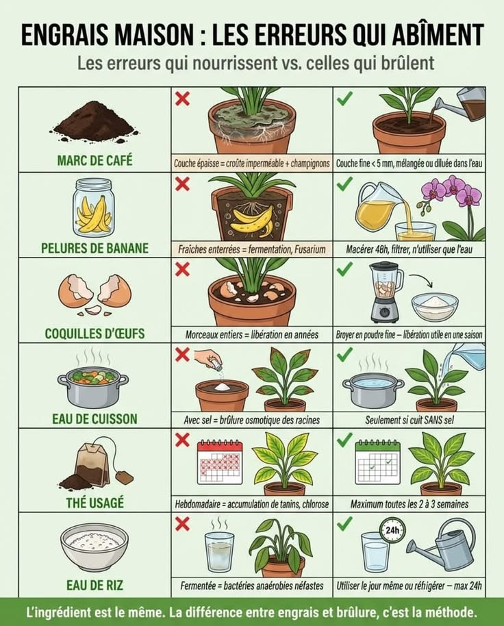

# Protocols (horticulture)

## Homemade fertilizers: the mistakes that damage your plants

Infographic translated from French. Key message: it is not the ingredient itself that is the problem, but **how you use it** — the same material can feed your plant or burn it.

| Ingredient | Mistake to avoid | Right method |
| ---------- | ---------------- | ------------ |
| Coffee grounds | Thick layer: forms an impermeable crust and attracts mushrooms/fungi | Thin layer (< 5 mm / 0.2 in), mixed into the soil or diluted in water |
| Banana peels | Fresh and whole: they ferment and can spread Fusarium | Soak for 48 h, strain, use only the water |
| Eggshells | Whole pieces: decompose too slowly (takes years) | Grind into a fine powder; released usefully within one season |
| Cooking water | Salted: causes osmotic burn of the roots | Only if the food was cooked without salt |
| Used tea | Weekly application: tannins build up and cause chlorosis (yellowing) | At most every 2 to 3 weeks |
| Rice water | Fermented: promotes harmful anaerobic bacteria | Use the same day, or refrigerate for up to 24 h |

**In short:** homemade fertilizers work well as long as they are properly prepared and dosed — dilution, grinding, soaking, and moderate frequency.

## Sources

- [Transcript: homemade fertilizers, the mistakes](files/homemade-fertilizers-mistakes.md) — translated from the French infographic "Engrais maison : les erreurs qui abîquent"
